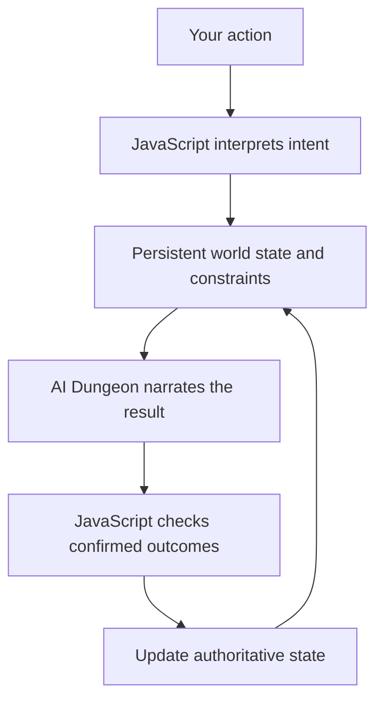

  
<div align="center">

# 🐉 THE DRAGON'S BARGAIN

### The king has run out of heroes. Now he's hiring a dragon.

**A procedural fantasy rescue adventure for AI Dungeon — with JavaScript-powered rules beneath the storytelling.**


*One princess. One archmage. One heavily defended fortress.*  
*And an unusually expensive solution to the kingdom's problems.*

</div>

---

## 🏰 The premise

Princess Valerie has been taken by a powerful wizard. King Aldric's champions have failed, his options are dwindling, and his herald has arrived at **your lair** with gold, gems, and the promise of royal hunting rights.

**You are the dragon.**

Name your price. Inspect the contract. Scout the stronghold. Talk your way in, slip through its defenses, dismantle its machinery, or hit the front gate like a falling mountain.

But the wizard has prepared for monsters like you — and the truth behind the princess's captivity may be more complicated than the king knows.

> **The bargain is offered. Whether you accept it — and what you do next — is yours.**

## ✨ What makes it different?

**The Dragon's Bargain** combines AI Dungeon's improvisational storytelling with a persistent, procedural JavaScript layer. The AI can describe the world in fresh language; the script keeps the important facts from changing every turn.

| Feature | What it means in play |
| --- | --- |
| 🐲 **Be the dragon** | Define your dragon's name, kind, size, appearance, temperament, lair, and even fluffiness. |
| 👑 **A mystery with teeth** | 30 possible hidden rescue situations and 20 independent princess personality profiles create different motives, clues, and complications. |
| 🏯 **A formidable fortress** | Procedural defenses, spatial approaches, wards, guardians, mechanisms, and layered obstacles exist *before* you encounter them. |
| 🎯 **Actions have consequences** | Reconnaissance, location, discoveries, alert, disabled machinery, and finite defensive resources can persist across turns. |
| 🧠 **More than brute force** | Explore stealth, engineering, deception, bargaining, retreat, and creative bypasses rather than a mandatory sequence of fights. |
| 📜 **A real bargain** | Terms, acceptance, obligations, and outcomes are tracked separately from what an NPC merely claims. |
| 🎲 **Designed for replayability** | Different seeds and hidden plot facts reshape the rescue without rewriting established facts mid-adventure. |

No tactical grid. No endless menu of required commands. **Describe what your dragon does in ordinary language.**

## ⚙️ How it works

The central design rule is simple:

**JavaScript owns the mechanics. AI Dungeon owns the prose. The player owns the decisions.**



The engine maintains scenario-owned data in `state.dragonsBargain`, including private seeded truths, fortress state, observations, resources, and outcomes. It uses the familiar AI Dungeon **Library / Input / Context / Output** scripting pattern.

The storyteller is intentionally free to improvise *how* events look and sound. It is **not** free to conjure unlimited ammunition, resurrect a destroyed defense, or declare a locked door open simply because the dragon asked nicely.

This is a **mechanical skeleton for an emergent story**, not a rigid adventure script.

## 🚀 Getting started

1. Open or create a suitable **AI Dungeon** scenario with JavaScript scripting enabled.
2. Use the matching release package to install the scenario's **Library, Input, Context, and Output** scripts, along with its supplied opening and Story Cards.
3. Follow the installation notes for your exact release; do not mix files from different builds.
4. Start a **new adventure**, create your dragon, and respond to the royal herald however you choose.
5. Play naturally. Use status commands when you want to inspect the mechanical situation.

> [!IMPORTANT]
> **Installing `v0.4.5-alpha.11`?** Use **`Candidate.txt`** for the Library tab. The archive's `Library.txt` is the previous alpha.10 reference, **not** the updated alpha.11 build.

### Optional in-game diagnostics

| Command | Purpose |
| --- | --- |
| `#FORTRESS STATUS` | Current fortress area, known approaches, and relevant defensive information |
| `#FORTRESS HELP` | Fortress-system command guidance |
| `#TOWER STATUS` | Progress through the procedural challenge structure |
| `#BARGAIN STATUS` | Current royal bargain state |
| `#BARGAIN HELP` | Bargain-system guidance |

The game is built for **natural-language play first**. These commands are optional inspection tools, not the primary interface.

### Related scripts

Supernatural powers and spells are registered and enforced by **Surge Protector** when that separate script is used. *The Dragon's Bargain* does not impersonate a spell system or change another module's registrations. Other script integrations should be treated as separate, opt-in work; ScriptBridge support is **planned, not implemented**.

## 🧪 Development and testing

This project uses test-driven development plus disposable **live AI Dungeon adventures**. Automated tests catch deterministic failures; live tests catch the wonderfully unpredictable wording of an AI storyteller.

Tests cover areas such as seeded generation, challenge progression, discovery, contract reconciliation, physical location, defense resource use, idempotence, and narrative-to-state reconciliation.

From an extracted development package with Node.js installed:

```bash
node tests/Run_All_Tests.js
node cycle3.test.cjs Cycle6.txt
node cycle4.test.cjs Cycle6.txt
node sustained.test.cjs Cycle6.txt
node infiltration.test.cjs Cycle6.txt
```

The `Cycle6.txt` commands above apply to the **Cycle 6 development checkpoint**; use the corresponding candidate filename from your own package. Passing offline tests is not, by itself, a claim of successful live gameplay.

## 🛠️ Road to 1.0

- [x] Seeded princess/wizard situations and procedural fortress foundations
- [x] Persistent reconnaissance and fortress location tracking
- [x] Defensive activation, depletion, disablement, and sustained-assault testing
- [ ] Complete and verify multiple infiltration, sabotage, and negotiated entry paths
- [ ] Live-verify the full rescue, confrontation, bargain, and ending loop
- [ ] Stress-test alternate outcomes, seeds, and existing-save compatibility
- [ ] Finish release hardening and complete end-to-end beta playthroughs

**Current status:** The latest packaged, live-tested sustained-defense milestone is **`v0.4.5-alpha.11`**. A **`v0.4.5-alpha.12` Cycle 6 development candidate** is under test; it is **not a completed release**. This project is actively evolving and is **not yet v1.0**.

## 🐛 Reporting issues

A useful bug report includes the **script version**, the **player's action**, the **AI's exact narration**, relevant **`[DB]` console logs**, and what the saved state did versus what should have happened. Please avoid sharing undiscovered private plot details in public issues when they would spoil another player's adventure.

---

<div align="center">

### 🐉 The kingdom needs a hero. Unfortunately for the kingdom, it hired you.

*The Dragon's Bargain — a story with an improvisational voice and a mechanical memory.*

</div>

## License

**Free to play. Free to experiment. Not for commercial exploitation.**

The JavaScript source code in this repository is licensed under the [PolyForm Noncommercial License 1.0.0](LICENSE-CODE.md).

You are welcome to use these scripts in your personal AI Dungeon adventures, study how they work, modify them, and share noncommercial adaptations in accordance with the license.

Commercial use, including selling the scripts or incorporating them into commercial software products, requires separate permission.

Original research papers, design documents, and written documentation are licensed under [Creative Commons Attribution-NonCommercial 4.0](https://creativecommons.org/licenses/by-nc/4.0/).

Copyright © 2026 Cinderlord88.

*Have fun. Make adventures. Break things. Just don't sell my work.*
